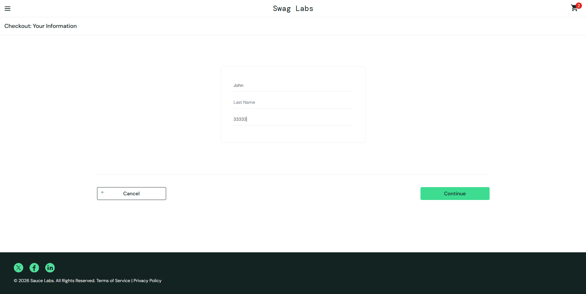

# BUG-001 – Le champ Last Name écrase le First Name (problem_user)

**Date de détection** : 10/10/2026  
**Détecté par** : Medhy  
**Environnement** : Chrome / Windows 11  
**URL** : https://www.saucedemo.com  
**Compte utilisé** : problem_user / secret_sauce  
**Sévérité** : Majeure  
**Priorité** : Haute  
**Statut** : Nouveau  

---

### Résumé
Lors de la saisie des informations de checkout avec le compte `problem_user`, le fait de renseigner le champ **Last Name** écrase automatiquement le contenu du champ **First Name** et laisse le champ **Last Name** vide.

---

### Étapes pour reproduire
1. Aller sur https://www.saucedemo.com
2. Se connecter avec le compte :  
   - Username : `problem_user`  
   - Password : `secret_sauce`
3. Ajouter n’importe quel produit au panier
4. Cliquer sur l’icône du panier
5. Cliquer sur le bouton **Checkout**
6. Dans le champ **First Name**, saisir par exemple : `John`
7. Dans le champ **Last Name**, saisir par exemple : `Doe`

---

### Résultat actuel (Actual Result)
- Le texte saisi dans **Last Name** remplace le contenu du champ **First Name**
- Le champ **Last Name** reste vide

---

### Résultat attendu (Expected Result)
- Le champ **First Name** conserve la valeur saisie (`John`)
- Le champ **Last Name** affiche la valeur saisie (`Doe`)

---

### Preuves

**Avant saisie du Last Name :**

**Après saisie du Last Name :**

---

### Notes supplémentaires
- Ce comportement ne se produit **pas** avec le compte `standard_user`.
- Bug spécifique au compte `problem_user`.