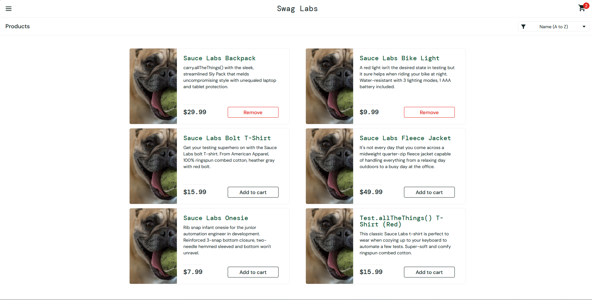

# BUG-002 – Toutes les images des produits sont identiques (problem_user)

**Date de détection** : 09/10/2026  
**Détecté par** : Medhy  
**Environnement** : Chrome / Windows 11  
**URL** : https://www.saucedemo.com  
**Compte utilisé** : problem_user / secret_sauce  
**Sévérité** : Moyenne  
**Priorité** : Moyenne  
**Statut** : Nouveau  

---

### Résumé
Avec le compte `problem_user`, toutes les images des produits affichés sur la page Inventory sont identiques.

---

### Étapes pour reproduire
1. Aller sur https://www.saucedemo.com
2. Se connecter avec :
   - Username : `problem_user`
   - Password : `secret_sauce`
3. Observer la page Inventory (liste des produits)

---

### Résultat actuel (Actual Result)
Toutes les images des 6 produits sont identiques (même visuel).

---

### Résultat attendu (Expected Result)
Chaque produit doit avoir sa propre image distinctive.

---

### Preuves

---

### Notes supplémentaires
- Ce comportement ne se produit pas avec le compte `standard_user`.
- Bug spécifique au compte `problem_user`.