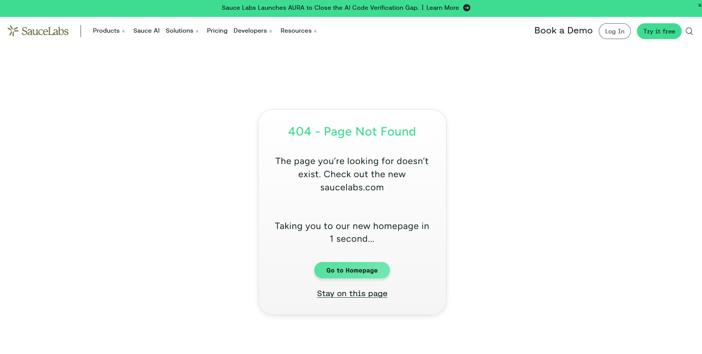

# BUG-003 – La page About renvoie une erreur 404

**Date de détection** : 09/10/2026  
**Détecté par** : Medhy  
**Environnement** : Chrome / Windows 11  
**URL** : https://www.saucedemo.com  
**Compte utilisé** : standard_user / secret_sauce  
**Sévérité** : Mineure  
**Priorité** : Basse  
**Statut** : Nouveau  

---

### Résumé
Le lien « About » présent dans le menu latéral redirige vers une page d’erreur 404.

---

### Étapes pour reproduire
1. Aller sur https://www.saucedemo.com
2. Se connecter avec un compte valide (ex: `standard_user`)
3. Cliquer sur le menu hamburger (en haut à gauche)
4. Cliquer sur le lien **About**

---

### Résultat actuel (Actual Result)
Une page d’erreur 404 (Not Found) s’affiche.

---

### Résultat attendu (Expected Result)
La page About devrait s’afficher correctement avec du contenu informatif.

---

### Preuves

---

### Notes supplémentaires
- Le problème est reproductible avec tous les comptes.
- Le lien About pointe vers une URL externe qui n’existe plus ou qui est incorrecte.